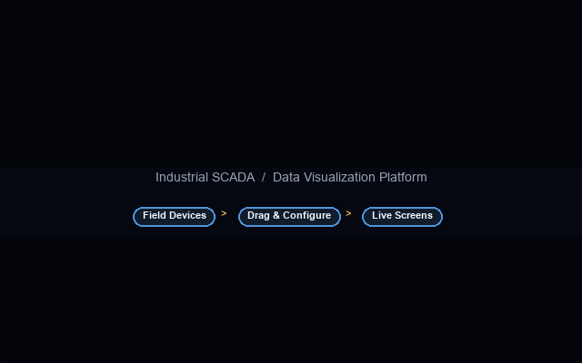
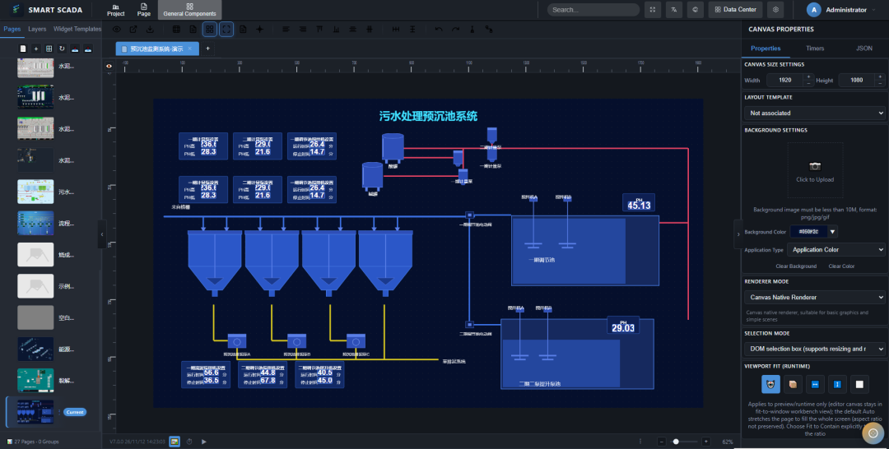
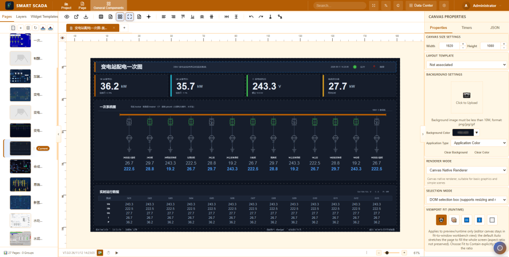

[English](./README.md) · [简体中文](./README.zh-CN.md) · [日本語](./README.ja.md) · **Deutsch** · [Español](./README.es.md)

# 🌈 Smart Site — Open-Source-SCADA/HMI-Software und Plattform zur Visualisierung industrieller Daten

Smart Site ist eine Open-Source-SCADA-Plattform für industrielle Anwendungen: **HMI-/SCADA-Editor, Datenplattform und Backend-Services** in einem integrierten System. Unterstützt werden Drag-and-Drop-Konfiguration von Prozessbildern, Gerätedatenerfassung (Modbus / OPC UA / MQTT / Siemens S7), Tags und Vorlagen, eine Alarm-Engine, eine Script-Engine, Berichte, Zeitreihenspeicherung und Mehrsprachigkeit.

> **Auch bekannt als SS Industrial Cloud** — die kommerzielle Plattform wird unter dieser Marke veröffentlicht; **Smart Site** ist der Name des Open-Source-Projekts für dasselbe Produkt.



> ✨✨✨ **Online-Demo** ✨✨✨
>
> - **URL**: <https://smartsite.top/?lang=de>
> - **Testkonto**: `test` / `test` (alle Funktionen von HMI-Editor und Datenplattform testen)
>
> Die Demo ist eine öffentlich geteilte Instanz. Alle Prozessbilder und Daten sind simuliert und dienen ausschließlich der Funktionsbewertung. Bitte keine wichtigen Geschäftsdaten eingeben.

> 📄 **Diese Seite ist eine deutsche Kurzfassung.** Die vollständige Dokumentation (Installation, Betrieb, Fehlerbehebung) ist auf Englisch und Chinesisch verfügbar.
> Details: [`docs/en`](./docs/en/README.md)

---

## 🎯 Welche Probleme löst Smart Site?

Antworten auf die fünf zentralen Schwachstellen herkömmlicher HMI-/SCADA-Software:

| Schwachstelle klassischer SCADA-Systeme | Lösung von Smart Site |
| --- | --- |
| **Lizenzierung nach Datenpunkten**: Abrechnung pro Tag, die Kosten steigen mit dem Projektumfang | Open Source und kostenlos (Apache-2.0), **unbegrenzte Tags**, keine Lizenzsperre |
| **Kompatibilität mit nationalen IT-Umgebungen (Xinchuang)**: Abhängigkeit von Windows + IE / ActiveX, schwer anpassbar | Reiner Web-Stack (Node.js + Vue3), **Linux-Deployment** möglich, läuft im Browser, keine ActiveX-Abhängigkeit |
| **Komplexität**: Projektmanager, IO-Server, Editor, Runtime, Historian – viele Prozesse und Komponenten, hoher Installations- und Wartungsaufwand | **All-in-one-Paket**: Erfassung, Konfiguration, Runtime und Historie in einem. Auspacken und starten (Windows-Paket / Docker), Doppelklick auf `start.bat` genügt |
| **Unvollständige Web-Funktionen**: WYSIWYG nur im Client, Qualitätsverlust bei der Web-Veröffentlichung | **Native Web-Architektur**: Editor und Runtime laufen im Browser, **WYSIWYG**, konsistente Darstellung auf Desktop und Mobilgeräten |
| **Geschlossene Erweiterbarkeit**: Closed-Source-Blackbox, schwer integrierbar im Zeitalter von KI | Modulares Design für das KI-Zeitalter – **Einheit zuerst, Einfachheit vorrangig**: Erfassung als Plug-in mit Prozessisolierung, Anzeige-Primitives als Verzeichnis-Plug-ins, getrennte Frontend-/Backend-Skripte, jede Stufe unabhängig erweiterbar |

Typische SCADA-Aufgaben:

- Zero-Code-Konfiguration von **Monitoring-Dashboards und HMI-Prozessbildern** für Fabriken, Wasserwerke, Kraftwerke und Pumpstationen
- **Multiprotokoll-Datenerfassung** und zentrale Verwaltung für Modbus, OPC UA, MQTT, S7 usw.
- **Echtzeitüberwachung, Verlaufskurven und Alarme** (quittieren / löschen / analysieren)
- **Wiederverwendung von Branchen- und Canvas-Vorlagen** für die schnelle Umsetzung ähnlicher Projekte

## ✨ Warum Smart Site?

| Merkmal | Beschreibung |
| --- | --- |
| 🎨 Drag-and-Drop-Konfiguration | Primitiv-Bibliothek (Industrie / Energie / SVG / 3D / Diagramme) + Canvas-Vorlagen + Layout-Vorlagen, WYSIWYG |
| 🔌 Multiprotokoll-Erfassung | Modbus TCP/RTU, OPC UA, MQTT, Siemens S7, virtueller Simulator, Plug-in-Collector |
| 📈 Echtzeit und Historie in einem | Echtzeit-Push über WebSocket, Zeitreihenspeicherung mit InfluxDB / SQLite, Verlaufskurven und Aggregationsabfragen |
| 🚨 Vollständige Alarm-Engine | Alarmregeln / Verzögerungsentprellung / Quittieren und Löschen / Maskierung / Event-Center / Alarmvariablen-Analyse |
| 🧩 Offene Erweiterbarkeit | Primitiv-Plug-in-SDK, Script-Engine (Monaco), externe Datenquellen, REST API + WebSocket |
| 📦 Sofort einsatzbereit | Windows-Einzelpaket (keine Installation, kein Build), Docker-Deployment, Einrichtungsassistent |

## ✨ Kernfunktionen

| Modul | Beschreibung |
| --- | --- |
| HMI-Editor | Drag-and-Drop-Bearbeitung, Datenbindung von Primitives, Animation / Karussell / Runtime-Vorschau, Mehrseitenverwaltung |
| Primitives und Assets | Industrie-Primitiv-Plug-ins (kategorieweise aktivierbar), Galerien für animierte GIFs / PNGs / Leuchtmelder / Schalter, Canvas- und Layout-Vorlagen |
| Datenplattform | Projektverwaltung, Seitenverwaltung, Geräteverwaltung (Gerätebaum / Gruppen / Status), Systemübersicht |
| Geräteerfassung | Collector-Plug-in-Verwaltung, Pipeline-Metriküberwachung, Tag-Bibliothek für Gerätevorlagen (DCS-/PLC-Branchenvorlagen) |
| Tags | Tag-Konfiguration, Skalierung / Totband / Umrechnung, Datentyp und Leserichtung, Echtzeitwert und Qualität |
| Alarme und Ereignisse | Alarmregeln, Alarmhistorie (quittieren / löschen / maskieren), Ereignisverlauf, Analyse von Alarmvariablen |
| Script-Engine | Online-Bearbeitung mit Monaco, Timer- und Ereignis-Trigger, Laufzeitüberwachung und Audit |
| Berichte | Berichtsschemata, Zusammenfassung und Detail (Zeilen-/Spalten-Pivot), Excel-Export |
| Verlaufsdaten | Verlaufskurven für mehrere Variablen, Aggregationsintervalle, gespeicherte Abfrageschemata |
| Systemverwaltung | Benutzer- und Rollenrechte, Menüs, Audit-Logs, Datenbankoperationen, Verwaltung der Basisdienste (Start / Stopp / Health-Check) |
| Mehrsprachigkeit | Chinesisch / Englisch und weitere Sprachen, helles und dunkles Theme |

## 🛠️ Technologie-Stack

| Ebene | Technologie |
| --- | --- |
| Frontend | Vue 3 · TypeScript · Vite · Pinia · Konva (Canvas-Rendering) · vue-i18n · Naive UI |
| Backend | NestJS · TypeORM · SQLite / InfluxDB · Socket.IO · JWT + RBAC |
| Protokoll-Erfassung | modbus-serial · node-opcua · mqtt · S7-Treiber · virtueller Simulator |
| Engineering | pnpm-Monorepo · Vitest / Jest · Playwright E2E · Windows-Paketierung |

## 🏗️ Voraussetzungen

| Umgebung | Anforderung | Hinweis |
| --- | --- | --- |
| Node.js | ≥ 18 (20 LTS empfohlen) | Build und Betrieb von Frontend und Backend |
| pnpm | ≥ 8 | Paketmanager (Monorepo-Workspace) |
| Betriebssystem | Windows / Linux | Entwicklung und Deployment |
| InfluxDB 2.7+ | Optional | Zeitreihenspeicherung (Fallback auf SQLite) |
| Redis | Optional | Echtzeit-Cache (Fallback auf Speicher) |

## 🚀 Schnellstart

- **Test ohne Installation (Windows)**: vorgefertigtes Paket herunterladen, entpacken und starten → <https://smartsite.top/downloads/ss-o/win-ss-v7.0.1.zip>
- **Aus dem Quellcode bauen**: Installations-, Start-, Build- und Deployment-Anleitung 👉 [`docs/en/01-getting-started.md`](./docs/en/01-getting-started.md) (Entwicklungsrichtlinien: [`AGENTS.md`](./AGENTS.md))

```powershell
# Start aus dem Quellcode (bin/-Skripte verwenden, nicht direkt pnpm dev)
.\bin\start.bat        # Vollstack: Editor 5173 + Backend 3000
.\bin\start-data.bat   # Nur Datenplattform (Frontend 5175 / Backend 4000)
.\bin\start-scada.bat  # Nur HMI-Editor (Frontend 5174 / Backend 4100)
```

## 🚨 Editionen: Open Source und Kommerziell

Smart Site verfolgt ein duales Modell aus **Open Source und kommerzieller Lizenz**:

| | Open Source (dieses Repository) | Kommerziell |
| --- | --- | --- |
| Lizenz | Apache-2.0, kommerzielle Nutzung erlaubt (Copyright-Hinweis beibehalten) | Kommerzielle Lizenz inkl. White-Label / Logo-Entfernung |
| HMI und Erfassung | HMI-Editor + Datenplattform + Multiprotokoll-Erfassung, **alle Kernfunktionen** | Enterprise-Erweiterungen nach Bedarf |
| RAG-Wissensbasis | — | ✅ Integrierte RAG-Wissensbasis: Suche und Q&A zu technischen Dokumenten, Handbüchern, FAQ |
| Skripting | Basisskripte (Timer-Trigger, Online-Bearbeitung) | ✅ Vollständiges Frontend-/Backend-Scripting: mehr APIs und Trigger, serverseitige Task-Orchestrierung |
| KI-Funktionen | — | ✅ Tiefe KI-Integration: Generierung und Verfeinerung von Geräten / Tags / Alarmregeln, KI-generierte HMI-Seiten |
| Mehrsprachigkeit | Grundlegende Unterstützung für Chinesisch / Englisch | ✅ Spracherweiterung, Terminologie-Datenbank, Übersetzungsmanagement |
| Support | Community (GitHub Issues) | Dedizierter Support mit SLA, Schulungen, kundenspezifische Entwicklung |
| Einsatz | Persönliches Lernen, kleine und mittlere Projekte, Produktvalidierung | Enterprise-Lieferung, Massen-Rollout, tiefe Branchenanpassung |

**Kommerzielle Lizenzierung / technische Beratung**: Bitte über [GitHub Issues](https://github.com/smartsite-ss/ss-scada/issues) kontaktieren. Kontakte für den chinesischen Markt (WeChat / Telefon) stehen im [englischen README](./README.md).

## 🖼️ Screenshots

Aktuelle Laufzeitansichten (alle 35 Screenshots im englischen README). Die Screenshots zeigen die englische Oberfläche.

**HMI-Editor — Kläranlage, Absetzbecken** (Drag-and-Drop-Konfiguration und Tag-Bindung)



**Schaltbild der Umspannungsverteilung** (Sammelschienen- und Feld-Primitives, Echtzeitüberwachung von Spannung und Leistung)



**Datenplattform — Systemübersicht** (Gerätestatistik, Statusverteilung, aktuelle Alarme)


**Geräteverwaltung** (Gerätebaum / Gruppen, Protokoll / Adresse / Erfassungsintervall, Online-Status)


**Berichtsverwaltung** (Aggregationszeitraum, Kennzahlen, Zeilen-/Spalten-Pivot, Excel-Export)


**Canvas-Vorlagen** (Alarm-Center / Dashboard / Datenbildschirm / Energiemanagement / HVAC usw.)


Alle 35 Screenshots mit ausführlichen Beschreibungen: [English README](./README.md)

## Lizenz

[Apache-2.0](./LICENSE)
