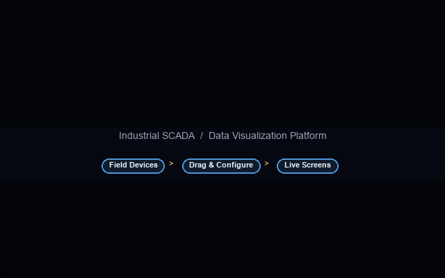
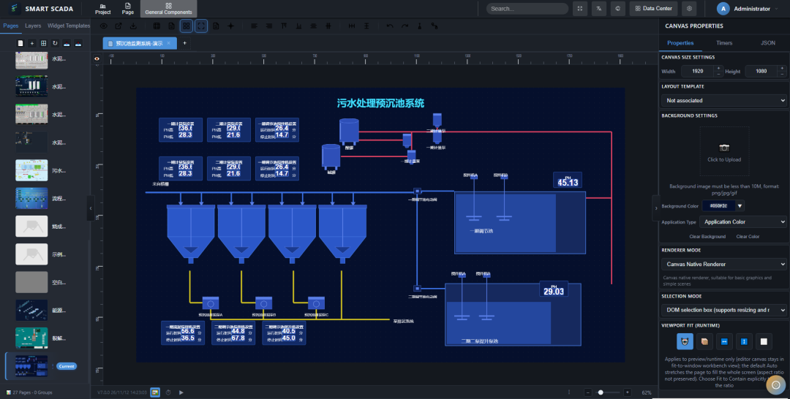
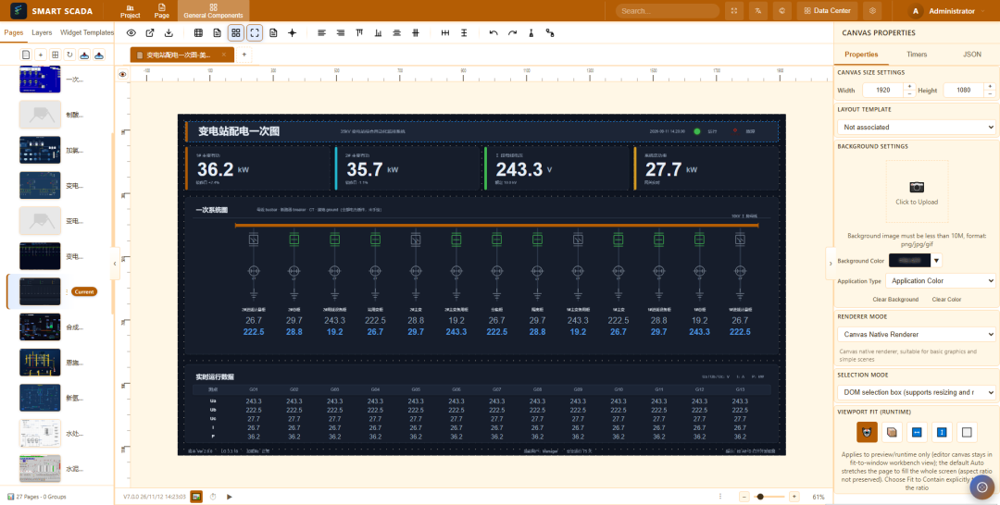

[English](./README.md) · [简体中文](./README.zh-CN.md) · [日本語](./README.ja.md) · [Deutsch](./README.de.md) · **Español**

# 🌈 Smart Site — Software SCADA/HMI de código abierto y plataforma de visualización de datos industriales

Smart Site es una plataforma SCADA de código abierto para entornos industriales: **editor HMI/SCADA, plataforma de datos y servicios backend** integrados en un solo producto. Incluye edición de pantallas de supervisión mediante arrastrar y soltar, adquisición de datos de dispositivos (Modbus / OPC UA / MQTT / Siemens S7), etiquetas y plantillas, motor de alarmas, motor de scripts, informes, almacenamiento de series temporales y soporte multilingüe.

> **También conocido como SS Industrial Cloud** — la plataforma comercial se publica con esa marca; **Smart Site** es el nombre del proyecto de código abierto del mismo producto.



> ✨✨✨ **Demostración en línea** ✨✨✨
>
> - **URL**: <https://smartsite.top/>
> - **Cuenta de prueba**: `test` / `test` (accede a todas las funciones del editor HMI y de la plataforma de datos)
>
> La demostración es una instancia pública compartida. Todas las pantallas y los datos son simulados y sirven únicamente para evaluar las funciones. No introduzca datos reales de producción.

> 📄 **Esta página es un resumen en español.** La documentación completa (instalación, operación y resolución de problemas) está disponible en inglés y chino.
> Más detalles: [`docs/en`](./docs/en/README.md)

---

## 🎯 ¿Qué problemas resuelve Smart Site?

Respuestas a los cinco puntos débiles del software HMI/SCADA tradicional:

| Punto débil del SCADA tradicional | Respuesta de Smart Site |
| --- | --- |
| **Licencias por número de puntos**: cobro por etiqueta, el coste crece con el proyecto | Código abierto y gratuito (Apache-2.0), **etiquetas ilimitadas**, sin bloqueo de licencia |
| **Compatibilidad con entornos IT nacionales (Xinchuang)**: depende de Windows + IE / ActiveX, difícil de adaptar | Stack web completo (Node.js + Vue3), **despliegue en Linux**, funciona en el navegador, sin dependencia de ActiveX |
| **Complejidad**: gestor de proyectos, servidor IO, editor, runtime, historiador… múltiples procesos y componentes, alto coste de instalación y mantenimiento | **Paquete todo en uno**: adquisición, configuración, runtime e histórico integrados. Se descomprime y funciona (paquete Windows / Docker); basta hacer doble clic en `start.bat` |
| **Capacidades web incompletas**: WYSIWYG solo en el cliente, la publicación web pierde fidelidad | **Arquitectura web nativa**: editor y runtime funcionan en el navegador, **WYSIWYG**, experiencia coherente en escritorio y móvil |
| **Extensibilidad cerrada**: caja negra de código cerrado, difícil de integrar en la era de la IA | Diseño modular para la era de la IA: **unidad primero, simplicidad ante todo**: adquisición como plug-in con aislamiento de procesos, primitivas de visualización como plug-ins basados en directorios, scripts de frontend y backend separados, cada etapa ampliable de forma independiente |

Casos habituales de ingeniería SCADA:

- Configuración sin código de **cuadros de mando y pantallas HMI** para fábricas, plantas de agua, centrales eléctricas y estaciones de bombeo
- **Adquisición multiprotocolo** y gestión unificada de Modbus, OPC UA, MQTT, S7, etc.
- **Supervisión en tiempo real, curvas históricas y alarmas** (reconocer / eliminar / analizar)
- **Reutilización de plantillas de sector y de lienzo** para replicar rápidamente proyectos similares

## ✨ ¿Por qué elegir Smart Site?

| Característica | Descripción |
| --- | --- |
| 🎨 Configuración por arrastrar y soltar | Biblioteca de primitivas (industrial / energía / SVG / 3D / gráficos) + plantillas de lienzo + plantillas de diseño, WYSIWYG |
| 🔌 Adquisición multiprotocolo | Modbus TCP/RTU, OPC UA, MQTT, Siemens S7, simulador virtual, colectores plug-in |
| 📈 Tiempo real e histórico integrados | Push en tiempo real por WebSocket, series temporales en InfluxDB / SQLite, curvas históricas y consultas agregadas |
| 🚨 Motor de alarmas completo | Reglas de alarma / retardo antirrebote / reconocer y eliminar / enmascarar / centro de eventos / análisis de variables de alarma |
| 🧩 Extensibilidad abierta | SDK de plug-ins de primitivas, motor de scripts (Monaco), fuentes de datos externas, REST API + WebSocket |
| 📦 Listo para usar | Paquete único para Windows (sin instalación ni compilación), despliegue Docker, asistente de inicialización |

## ✨ Funciones principales

| Módulo | Descripción |
| --- | --- |
| Editor HMI | Edición de pantallas por arrastrar y soltar, enlace de datos de primitivas, animación / carrusel / vista previa en runtime, gestión multipágina |
| Primitivas y recursos | Plug-ins de primitivas industriales (activación por categoría), galerías de GIF animados / PNG / pilotos / interruptores, plantillas de lienzo y de diseño |
| Plataforma de datos | Gestión de proyectos, gestión de páginas, gestión de dispositivos (árbol / grupos / estado), visión general del sistema |
| Adquisición de dispositivos | Gestión de plug-ins colectores, supervisión de métricas de Pipeline, biblioteca de etiquetas de plantillas de dispositivo (plantillas DCS / PLC) |
| Etiquetas | Configuración de etiquetas, escalado / banda muerta / conversión, tipo de dato y sentido de lectura/escritura, valor en tiempo real y calidad |
| Alarmas y eventos | Reglas de alarma, registros de alarma (reconocer / eliminar / enmascarar), historial de eventos, análisis de variables de alarma |
| Motor de scripts | Edición en línea con Monaco, disparadores por temporizador y eventos, supervisión y auditoría de ejecución |
| Informes | Esquemas de informe, resumen y detalle (pivot de filas/columnas), exportación a Excel |
| Datos históricos | Curvas históricas multivariable, intervalos de agregación, esquemas de consulta guardados |
| Gestión del sistema | Permisos de usuario y roles, menús, registros de auditoría, operaciones de base de datos, gestión de servicios base (iniciar / detener / health check) |
| Multilingüe | Chino / inglés y otros idiomas, temas claro y oscuro |

## 🛠️ Stack tecnológico

| Capa | Tecnología |
| --- | --- |
| Frontend | Vue 3 · TypeScript · Vite · Pinia · Konva (renderizado canvas) · vue-i18n · Naive UI |
| Backend | NestJS · TypeORM · SQLite / InfluxDB · Socket.IO · JWT + RBAC |
| Adquisición de protocolos | modbus-serial · node-opcua · mqtt · driver S7 · simulador virtual |
| Ingeniería | Monorepo pnpm · Vitest / Jest · Playwright E2E · empaquetado para Windows |

## 🏗️ Requisitos

| Entorno | Requisito | Nota |
| --- | --- | --- |
| Node.js | ≥ 18 (se recomienda 20 LTS) | Compilación y ejecución de frontend y backend |
| pnpm | ≥ 8 | Gestor de paquetes (workspace del monorepo) |
| Sistema operativo | Windows / Linux | Desarrollo y despliegue |
| InfluxDB 2.7+ | Opcional | Series temporales (si no está disponible, usa SQLite) |
| Redis | Opcional | Caché de datos en tiempo real (si no está disponible, usa memoria) |

## 🚀 Inicio rápido

- **Prueba sin instalación (Windows)**: descarga el paquete ya compilado, descomprime y ejecuta → <https://smartsite.top/downloads/ss-o/win-ss-v7.0.1.zip>
- **Compilar desde el código fuente**: guía de instalación, arranque, compilación y despliegue 👉 [`docs/en/01-getting-started.md`](./docs/en/01-getting-started.md) (convenciones de desarrollo en [`AGENTS.md`](./AGENTS.md))

```powershell
# Arranque desde el código fuente (usar los scripts de bin/; no ejecutar pnpm dev directamente)
.\bin\start.bat        # Stack completo: editor 5173 + backend 3000
.\bin\start-data.bat   # Solo plataforma de datos (frontend 5175 / backend 4000)
.\bin\start-scada.bat  # Solo editor HMI (frontend 5174 / backend 4100)
```

## 🚨 Ediciones: código abierto y comercial

Smart Site aplica un modelo dual de **código abierto + licencia comercial**:

| | Código abierto (este repositorio) | Comercial |
| --- | --- | --- |
| Licencia | Apache-2.0, uso comercial permitido (mantener el aviso de copyright) | Licencia comercial, incluido white-label / eliminación de logotipo |
| HMI y adquisición | Editor HMI + plataforma de datos + adquisición multiprotocolo, **todas las funciones principales** | Ampliaciones empresariales según necesidad |
| Base de conocimiento RAG | — | ✅ Base RAG integrada: búsqueda y Q&A sobre documentación técnica, manuales y FAQ |
| Scripts | Scripts básicos (disparadores por temporizador, edición en línea) | ✅ Scripting completo de frontend y backend: más APIs y disparadores, orquestación de tareas en servidor |
| Funciones de IA | — | ✅ Integración profunda de IA: generación y refinamiento de dispositivos / etiquetas / reglas de alarma, generación de pantallas HMI por IA |
| Multilingüe | Soporte básico de chino / inglés | ✅ Ampliación de idiomas, base terminológica y gestión de traducciones |
| Soporte | Comunidad (GitHub Issues) | Soporte dedicado con SLA, formación y desarrollo a medida |
| Uso | Aprendizaje personal, proyectos pequeños y medianos, validación de producto | Entrega empresarial, despliegue masivo, personalización sectorial profunda |

**Licencias comerciales y consultoría técnica**: contactar mediante [GitHub Issues](https://github.com/smartsite-ss/ss-scada/issues). Los contactos para el mercado chino (WeChat / teléfono) figuran en el [README en inglés](./README.md).

## 🖼️ Capturas de pantalla

Imágenes reales de ejecución (las 35 capturas están en el README en inglés). Las capturas muestran la interfaz en inglés.

**Editor HMI — depuradora, tanque de sedimentación** (configuración por arrastrar y soltar y enlace de etiquetas)



**Diagrama unifilar de distribución de subestación** (primitivas de barras y celdas, supervisión en tiempo real de tensión y potencia)



**Plataforma de datos — visión general** (estadísticas de dispositivos, distribución de estados, alarmas recientes)


**Gestión de dispositivos** (árbol / grupos, protocolo / dirección / intervalo de adquisición, estado en línea)


**Gestión de informes** (periodo de agregación, métricas, pivot de filas/columnas, exportación a Excel)


**Plantillas de lienzo** (centro de alarmas / dashboard / pantalla de datos / gestión energética / HVAC, etc.)


Las 35 capturas con descripciones detalladas: [English README](./README.md)

## Licencia

[Apache-2.0](./LICENSE)
