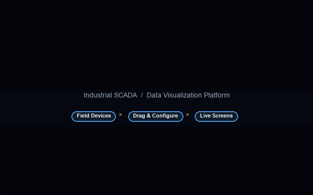
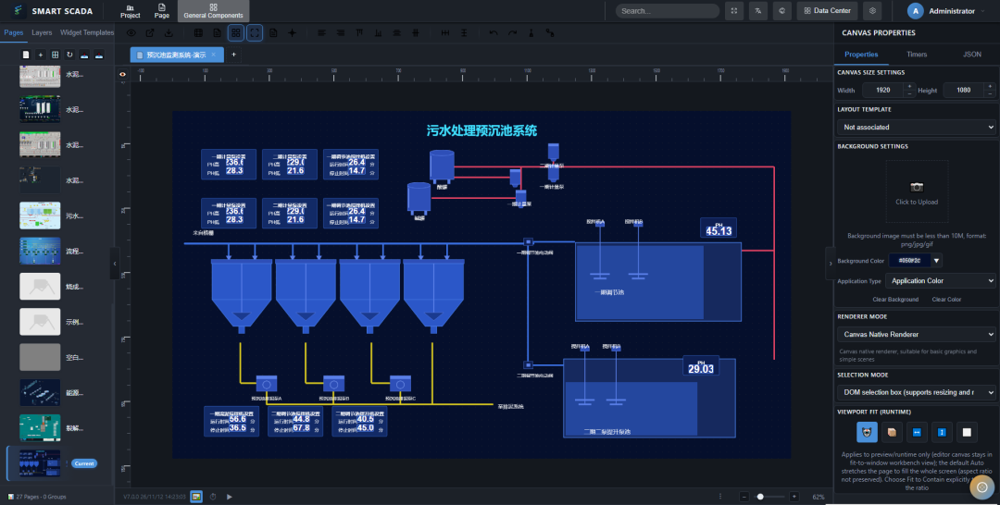
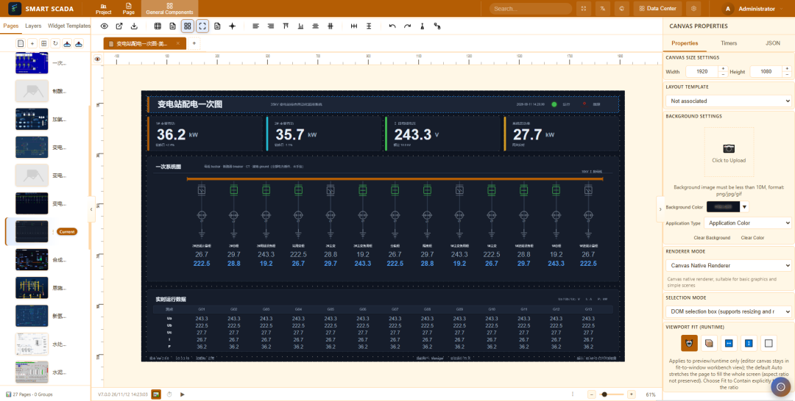

[English](./README.md) · [简体中文](./README.zh-CN.md) · **日本語** · [Deutsch](./README.de.md) · [Español](./README.es.md)

# 🌈 Smart Site — オープンソース SCADA / HMI ソフトウェア・産業データ可視化プラットフォーム

Smart Site は産業向けのオープンソース SCADA プラットフォームです。**HMI / SCADA エディター、データ管理基盤、バックエンドサービス**を一体化し、ドラッグ＆ドロップによる監視画面の作成、デバイスデータ収集（Modbus / OPC UA / MQTT / Siemens S7）、タグとテンプレート、アラームエンジン、スクリプトエンジン、レポート、時系列データ保存、多言語対応を提供します。

> **別名 SS Industrial Cloud** —— 商用版はこのブランド名で提供されており、**Smart Site** は同一製品のオープンソースプロジェクト名です。



> ✨✨✨ **オンラインデモ** ✨✨✨
>
> - **URL**: <https://smartsite.top/?lang=ja>
> - **テストアカウント**: `test` / `test`（HMI エディターとデータ管理基盤の全機能を試せます）
>
> デモは公開の共有インスタンスです。画面とデータはすべてシミュレーションで、機能評価のみを目的としています。重要な業務データは入力しないでください。

> 📄 **このページは日本語の概要版です。** 導入手順・運用・トラブルシューティングを含む完全なドキュメントは、英語と中国語で提供しています。
> 詳細: [`docs/en`](./docs/en/README.md)

---

## 🎯 Smart Site が解決する課題

従来の HMI / SCADA ソフトウェアが抱える 5 つの課題に対する答え:

| 従来型 SCADA の課題 | Smart Site の解決策 |
| --- | --- |
| **ポイント数ライセンス**: タグ数で課金され、プロジェクト規模とともにコストが増える | オープンソースで無償（Apache-2.0）、**タグ数無制限**、ライセンスロックなし |
| **中国国内 IT 環境への対応**: Windows + IE / ActiveX 依存で、国産環境への適応が難しい | フル Web スタック（Node.js + Vue3）、**Linux 展開**に対応、ブラウザだけで動作し ActiveX 不要 |
| **構成が複雑**: プロジェクトマネージャー、IO サーバー、エディター、ランタイム、ヒストリアン…多数のプロセスとコンポーネントで導入・保守コストが高い | **オールインワンパッケージ**: 収集・設定・ランタイム・履歴保存を一体化。解凍してすぐ使える（Windows 単一パッケージ / Docker）。`start.bat` をダブルクリックすれば稼働 |
| **Web 機能が不完全**: クライアントのみ WYSIWYG で、Web 公開時の再現性が低い | **ネイティブ Web アーキテクチャ**: エディターとランタイムが同一ブラウザ上で動作し、**WYSIWYG**、デスクトップ / モバイルで一貫した体験 |
| **拡張性が閉じている**: クローズドソースのブラックボックスで、AI 時代の統合や二次開発が難しい | AGI 時代に向けたモジュール設計 — **統一優先・シンプル重視**: 収集プラグイン化 + プロセス分離、表示プリミティブのプラグイン化 + ディレクトリ化、フロント / バックエンドスクリプトの分離、各段階を独立して拡張可能 |

日常的な SCADA エンジニアリング領域:

- 工場・浄水場・発電所・ポンプ場の**監視ダッシュボードと HMI 画面**をゼロコードで構築
- Modbus、OPC UA、MQTT、S7 などの**マルチプロトコルデータ収集**と一元管理
- デバイスデータの**リアルタイム監視、履歴トレンド、アラーム**（確認 / 解除 / 分析）
- **業界テンプレートとキャンバステンプレート**の再利用で、類似プロジェクトを短期間に複製

## ✨ Smart Site を選ぶ理由

| 特長 | 内容 |
| --- | --- |
| 🎨 ドラッグ＆ドロップ設定 | プリミティブライブラリ（産業 / 電力 / SVG / 3D / チャートなど）+ キャンバステンプレート + レイアウトテンプレート、WYSIWYG |
| 🔌 マルチプロトコル収集 | Modbus TCP/RTU、OPC UA、MQTT、Siemens S7、仮想シミュレータ、プラグイン式コレクター |
| 📈 リアルタイムと履歴を一体化 | WebSocket によるリアルタイム配信、InfluxDB / SQLite による時系列保存、履歴カーブと集計クエリ |
| 🚨 充実したアラームエンジン | アラームルール / 遅延デバウンス / 確認・解除 / マスク / イベントセンター / アラーム変数分析 |
| 🧩 オープンな拡張性 | プリミティブプラグイン SDK、スクリプトエンジン（Monaco）、外部データソース、REST API + WebSocket |
| 📦 すぐに使える | Windows 単一パッケージ（インストール・ビルド不要）、Docker 展開、初期化ウィザード |

## ✨ 主な機能

| モジュール | 内容 |
| --- | --- |
| HMI エディター | ドラッグ＆ドロップでの画面編集、プリミティブのデータバインド、アニメーション / カルーセル / ランタイムプレビュー、マルチページ管理 |
| プリミティブと素材 | 産業プリミティブプラグイン（カテゴリ単位で有効 / 無効）、動画 GIF / PNG / 表示灯 / スイッチボタンのギャラリー、キャンバス / レイアウトテンプレート |
| データ管理基盤 | プロジェクト管理、ページ管理、デバイス管理（デバイスツリー / グループ / ステータス）、システム概要 |
| デバイス収集 | コレクタープラグイン管理、Pipeline メトリクス監視、デバイステンプレートのタグライブラリ（DCS / PLC 業界テンプレート） |
| タグ | タグ設定、スケーリング / デッドバンド / 変換、データ型と読み書き方向、リアルタイム値と品質 |
| アラームとイベント | アラームルール、アラーム記録（確認 / 解除 / マスク）、イベント履歴、アラーム変数分析 |
| スクリプトエンジン | Monaco によるオンライン編集、タイマー / イベントトリガー、実行監視と監査 |
| レポート | レポートスキーム、サマリーと明細（行 / 列ピボット）、Excel 出力 |
| 履歴データ | 複数変数の履歴カーブ、集計間隔、クエリスキームの保存 |
| システム管理 | ユーザー / ロール権限、メニュー、監査ログ、データベース操作、基盤サービスの管理（起動 / 停止 / ヘルスチェック） |
| 多言語 | 中国語 / 英語をはじめとする多言語対応、ライト / ダークテーマ |

## 🛠️ 技術スタック

| レイヤー | 技術 |
| --- | --- |
| フロントエンド | Vue 3 · TypeScript · Vite · Pinia · Konva（キャンバス描画）· vue-i18n · Naive UI |
| バックエンド | NestJS · TypeORM · SQLite / InfluxDB · Socket.IO · JWT + RBAC |
| プロトコル収集 | modbus-serial · node-opcua · mqtt · S7 ドライバー · 仮想シミュレータ |
| 開発基盤 | pnpm monorepo · Vitest / Jest · Playwright E2E · Windows 単一パッケージリリース |

## 🏗️ 動作環境

| 環境 | 要件 | 補足 |
| --- | --- | --- |
| Node.js | 18 以上（20 LTS 推奨） | フロントエンドとバックエンドのビルド・実行 |
| pnpm | 8 以上 | パッケージマネージャー（monorepo workspace） |
| OS | Windows / Linux | 開発・展開の両方に対応 |
| InfluxDB 2.7+ | 任意 | 時系列保存（未導入時は SQLite にフォールバック） |
| Redis | 任意 | リアルタイムデータキャッシュ（未導入時はメモリにフォールバック） |

## 🚀 クイックスタート

- **インストール不要の試用（Windows）**: ビルド済みパッケージをダウンロードして解凍・実行 → <https://smartsite.top/downloads/ss-o/win-ss-v7.0.1.zip>
- **ソースからビルド**: 導入手順・起動・ビルド・展開ガイド 👉 [`docs/en/01-getting-started.md`](./docs/en/01-getting-started.md)（開発規約は [`AGENTS.md`](./AGENTS.md)）

```powershell
# ソースからの起動（bin/ スクリプトを使用し、pnpm dev は直接実行しないでください）
.\bin\start.bat        # フルスタック: エディター 5173 + バックエンド 3000
.\bin\start-data.bat   # データ管理基盤のみ（フロントエンド 5175 / バックエンド 4000）
.\bin\start-scada.bat  # HMI エディターのみ（フロントエンド 5174 / バックエンド 4100）
```

## 🚨 エディション: オープンソース版と商用版

Smart Site は **オープンソース + 商用** のデュアルトラックモデルを採用しています:

| | オープンソース版（本リポジトリ） | 商用版 |
| --- | --- | --- |
| ライセンス | Apache-2.0、商用利用可（著作権表示の保持が必要） | 商用ライセンス（ホワイトラベル / ロゴ削除を含む） |
| HMI とデータ収集 | HMI エディター + データ管理基盤 + マルチプロトコル収集、**すべてのコア機能** | 必要に応じたエンタープライズ拡張 |
| RAG ナレッジベース | — | ✅ 組み込み RAG ナレッジベース: 技術文書 / マニュアル / FAQ の検索と Q&A |
| スクリプト | 基本スクリプト（タイマートリガー、オンライン編集） | ✅ フロント / バックエンド双方のスクリプト: より豊富な API とトリガー、サーバー側タスク編成 |
| AI 機能 | — | ✅ AI の深層統合: デバイス / タグ / アラームルールの生成・改善、AI による HMI 画面生成 |
| 多言語 | 中国語 / 英語を中心とした基本対応 | ✅ 言語拡張、用語ベース、翻訳管理 |
| サポート | コミュニティ（GitHub Issues） | 専任サポートと SLA、トレーニング、カスタム開発 |
| 用途 | 個人学習、中小規模プロジェクト、製品検証 | 企業納入、大量展開、業界向けの深いカスタマイズ |

**商用ライセンス・技術相談**: [GitHub Issues](https://github.com/smartsite-ss/ss-scada/issues) からお問い合わせください。中国国内向けの連絡先（WeChat / 電話）は[英語版 README](./README.md)に記載しています。

## 🖼️ スクリーンショット

実際の実行画面です（全 35 枚は英語版 README に掲載）。画面キャプチャは英語 UI です。

**HMI エディター — 下水処理・沈殿池システム**（ドラッグ＆ドロップ設定とタグのバインド）



**変電所の配電単線図**（母線・配電区画のプリミティブと電圧 / 電力のリアルタイム監視）



**データ管理基盤 — システム概要**（デバイス統計、ステータス分布、最近のアラーム）


**デバイス管理**（デバイスツリー / グループ、プロトコル / アドレス / 収集周期、オンライン状態）


**レポート管理**（集計期間、指標サマリー、行 / 列ピボット、Excel 出力）


**キャンバステンプレート**（アラームセンター / ダッシュボード / データ画面 / エネルギー管理 / HVAC など）


全 35 枚のスクリーンショットと詳細な説明: [English README](./README.md)

## ライセンス

[Apache-2.0](./LICENSE)
