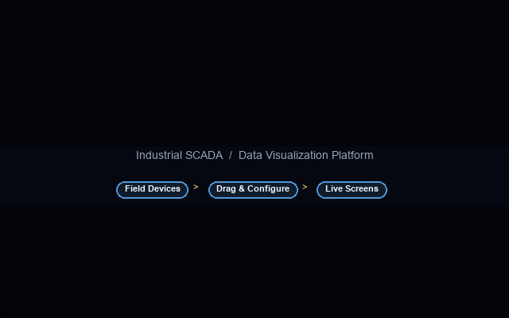
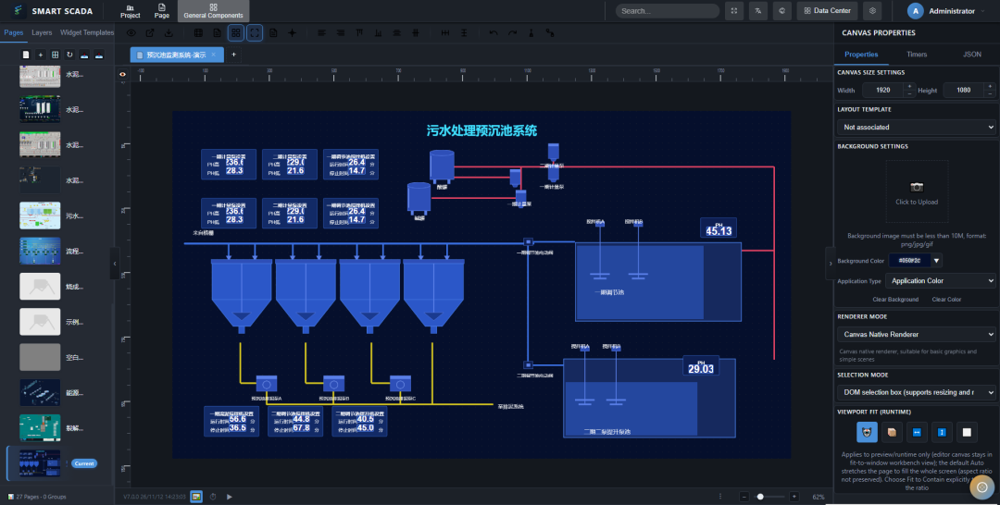
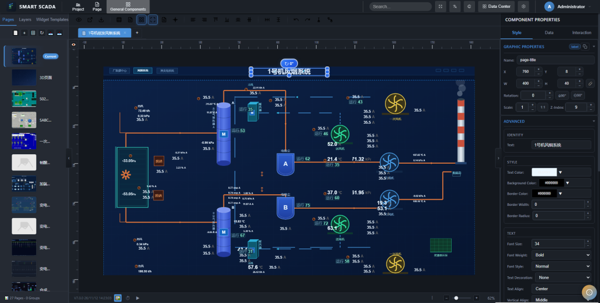
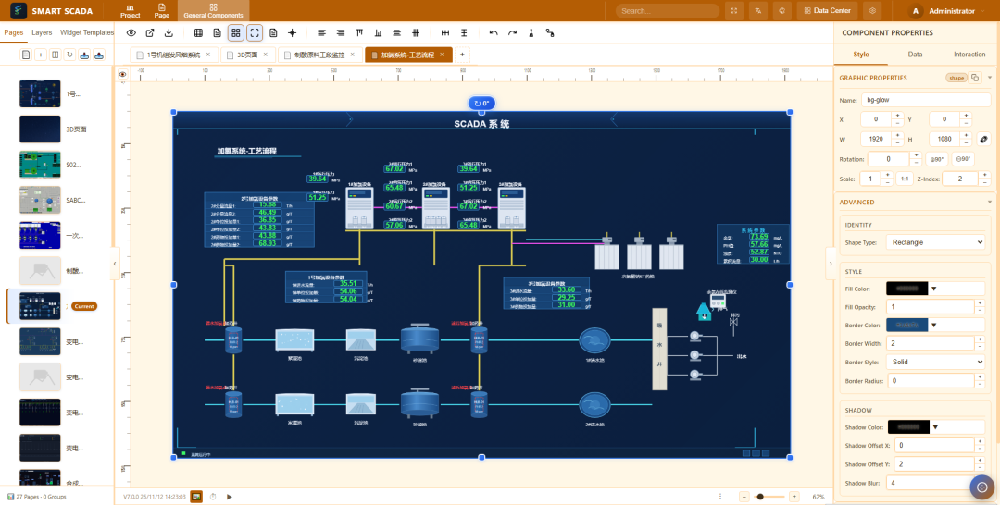
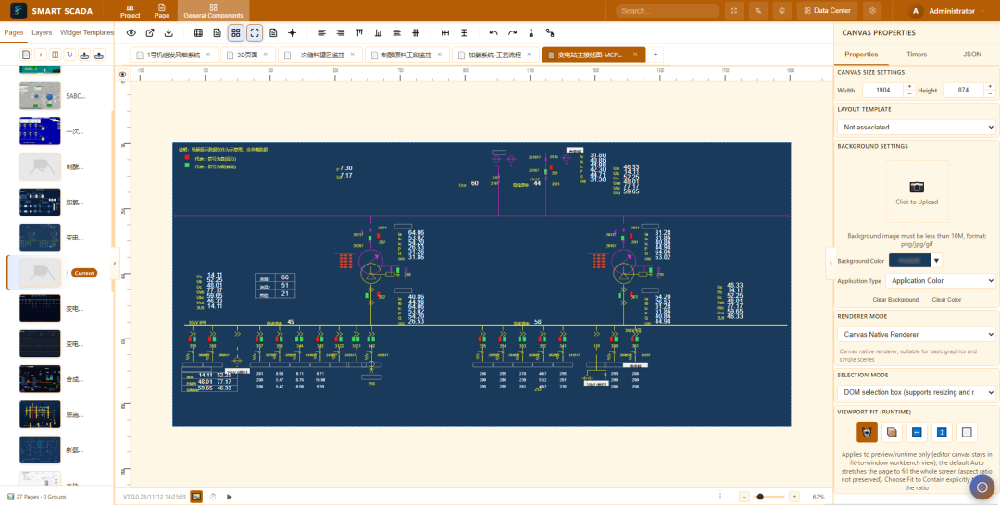
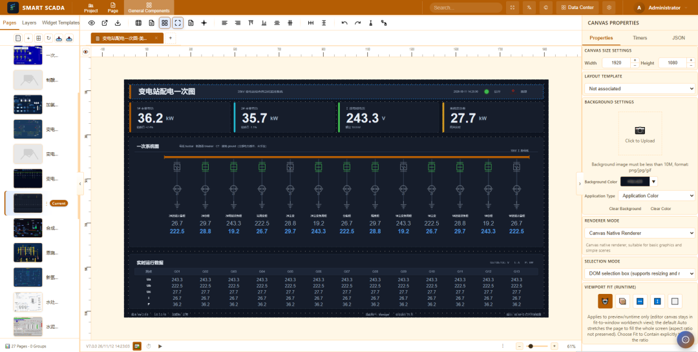
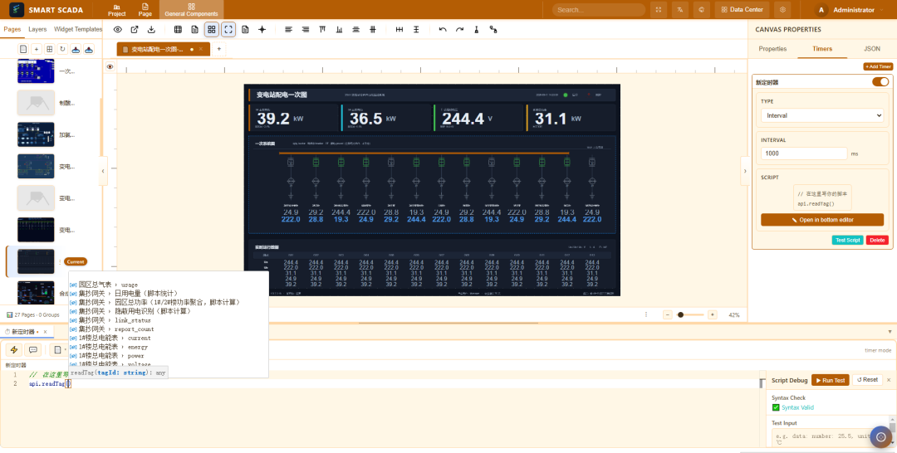

**English** · [简体中文](./README.zh-CN.md)

# 🌈 Smart Site — Open-Source SCADA HMI Software & Industrial Data Visualization Platform

Smart Site is an open-source SCADA platform for industrial scenarios: an integrated **HMI / SCADA editor + data middle platform + backend services**. It supports drag-and-drop monitoring screen editing, device data acquisition (Modbus / OPC UA / MQTT / Siemens S7), data tags and templates, an alarm engine, a script engine, reporting, time-series data storage, and multi-language internationalization.



> ✨✨✨ **Online Demo** ✨✨✨
>
> - **URL**: <https://smartsite.top/>
> - **Test account**: `test` / `test` (log in to explore all features of the HMI editor and data middle platform)
>
> The demo site is a public shared instance. All process screens and data are simulated and are for feature evaluation only — please do not write important business data.

If this project helps you, please give it a **Star** ⭐️ — your support keeps us updating 🚀

---

## 🎯 What Problems Does Smart Site Solve?

Answers to the five major pain points of traditional HMI/SCADA software:

| Pain point of traditional SCADA | Smart Site's answer |
| --- | --- |
| **Point-count licensing**: charged per tag, cost grows with project size | Open source and free (Apache-2.0), **unlimited tags**, no license lock |
| **Xinchuang (domestic IT) support**: depends on Windows + IE / ActiveX, hard to adapt domestically | Full web stack (Node.js + Vue3), supports **Linux deployment and domestic environments**, browser-based, no ActiveX dependency |
| **Complexity**: project manager, IO server, HMI editor, runtime, historian… multiple processes and components, costly to install and maintain | **Single integrated package**: acquisition, configuration, runtime and historian in one, ready to run out of the box (Windows single package / Docker), double-click `start.bat` to go online |
| **Incomplete web capabilities**: WYSIWYG only in the client, degraded web publishing | **Native web architecture**: both editor and runtime are browser-based, **WYSIWYG**, consistent desktop / mobile experience |
| **Closed extensibility**: closed source black box, hard to integrate or extend in the AI era | Modular design for the AGI era — **unified first, simplicity first**: pluggable and process-isolated data acquisition, directory-based pluggable display primitives, separated front/back-end scripting, every stage independently extensible |

It also covers day-to-day SCADA engineering scenarios:

- Zero-code configuration of **monitoring dashboards and HMI screens** for factories / water plants / power plants / pump stations
- **Multi-protocol device data acquisition** and unified management for Modbus, OPC UA, MQTT, S7, etc.
- **Real-time monitoring, historical trends and alarms** for device data (acknowledge / clear / analyze)
- **Reuse of industry templates and canvas templates** to quickly replicate similar projects

## ✨ Why Choose Smart Site?

| Highlight | Description |
| --- | --- |
| 🎨 Drag-and-drop configuration | Primitive library (industrial / power / SVG / 3D / charts, etc.) + canvas templates + layout templates, WYSIWYG |
| 🔌 Multi-protocol acquisition | Modbus TCP/RTU, OPC UA, MQTT, Siemens S7, Virtual simulator, pluggable collectors |
| 📈 Real-time + historian in one | WebSocket real-time push, InfluxDB / SQLite time-series storage, historical curves and aggregate queries |
| 🚨 Complete alarm engine | Alarm rules / delay debounce / acknowledge & clear / masking / event center / alarm data analysis |
| 🧩 Open extensibility | Primitive plugin SDK, script engine (Monaco), external data sources, REST API + WebSocket |
| 📦 Ready out of the box | Windows single-package release (no install, no build), Docker deployment, initialization wizard |

## ✨ Core Features

| Module | Description |
| --- | --- |
| HMI editor | Drag-and-drop screen editing, primitive data binding, animation / carousel / runtime preview, multi-page management |
| Primitives & assets | Industrial primitive plugins (per-category enable/disable), animated GIF / PNG / indicator light / switch button galleries, canvas / layout templates |
| Data middle platform | Project management, page management, device management (device tree / groups / status), system overview |
| Device acquisition | Collector plugin management, Pipeline metric monitoring, device template tag library (DCS / PLC industry templates) |
| Data tags | Tag configuration, scale / deadband / conversion, data type and read-write direction, real-time value and quality |
| Alarms & events | Alarm rules, alarm records (acknowledge / clear / mask), event history, alarm variable analysis |
| Script engine | Monaco online editing, timer / event triggers, runtime monitoring and audit |
| Reporting | Report schemes, summary and detail (row/column pivot), Excel export |
| Historical data | Multi-variable historical curves, aggregation intervals, saved query schemes |
| System management | User / role permissions, menus, audit logs, database operations, base service management (start/stop / health check) |
| Internationalization | Chinese / English / multi-language support, light and dark themes |

## 🛠️ Tech Stack

| Layer | Technology |
| --- | --- |
| Frontend | Vue 3 · TypeScript · Vite · Pinia · Konva (canvas rendering) · vue-i18n · Naive UI |
| Backend | NestJS · TypeORM · SQLite / InfluxDB · Socket.IO · JWT + RBAC |
| Protocol acquisition | modbus-serial · node-opcua · mqtt · snap7-like S7 driver · virtual simulator |
| Engineering | pnpm monorepo · Vitest / Jest · Playwright E2E · Windows single-package releaser |

## 🏗️ Requirements

| Environment | Requirement | Notes |
| --- | --- | --- |
| Node.js | ≥ 18 (20 LTS recommended) | Build and run frontend and backend |
| pnpm | ≥ 8 | Package manager (monorepo workspace) |
| OS | Windows / Linux | Both development and deployment supported |
| InfluxDB 2.7+ | Optional | Time-series storage (falls back to SQLite if absent) |
| Redis | Optional | Real-time data cache (falls back to memory if absent) |

## 🚀 Quick Start

- **No-install trial (Windows)**: download the prebuilt package, unzip and run → <https://smartsite.top/downloads/ss-o/win-ss-v7.0.1.zip>
- **Build from source**: full installation, startup, build and deployment guide 👉 [`docs/zh-CN/01-getting-started.md`](./docs/zh-CN/01-getting-started.md) (see [`AGENTS.md`](./AGENTS.md) for development conventions)

```powershell
# Start from source (use the bin/ scripts; do not run pnpm dev directly)
.\bin\start.bat        # Full stack: editor 5173 + backend 3000
.\bin\start-data.bat   # Data middle platform only (frontend 5175 / backend 4000)
.\bin\start-scada.bat  # HMI editor only (frontend 5174 / backend 4100)
```

## 🚨 Editions: Open Source vs Commercial

Smart Site uses a dual-track **open source + commercial** model:

| | Open Source (this repo) | Commercial |
| --- | --- | --- |
| License | Apache-2.0, free for commercial use (keep copyright notice) | Commercial license incl. white-label / logo removal |
| HMI & acquisition | HMI editor + data middle platform + multi-protocol acquisition, **all core features** | Enterprise extensions on demand |
| RAG knowledge base | — | ✅ Built-in RAG knowledge base: intelligent retrieval and Q&A over engineering docs / manuals / FAQ |
| Scripting | Basic scripts (timer triggers, online editing) | ✅ Full front & back-end scripting: richer APIs and triggers, server-side task orchestration |
| AI capabilities | — | ✅ Deep AI integration: generate and refine engineering data (devices / tags / alarm rules), AI-generated HMI pages |
| Multi-language | Basic Chinese / English support | ✅ Extended language support: language expansion, terminology base and translation management |
| Support | Community (Gitee / GitHub issues) | Dedicated technical support and SLA, training, custom development |
| Use case | Personal learning, small & medium projects, product validation | Enterprise delivery, bulk deployment, deep industry customization |

**Commercial cooperation / technical consulting contacts**:

<table>
  <tr>
    <td align="center"><br/><strong>Official WeChat Account</strong><br/>Product news and updates</td>
    <td align="center"><br/><strong>Video Account</strong><br/>Product demos and tutorials</td>
    <td align="center"><br/><strong>Developer WeChat</strong><br/>Technical exchange and business consulting</td>
  </tr>
</table>

**Phone**: 15116488853 (technical consulting and business cooperation)

> If this project helps you, please **follow our official and video accounts**, and **like & share** it with more people who need it.

---

## 🖼️ Screenshots

Below are runtime interface screenshots (stored in the repository's `docs/screenshots/` directory, corresponding to the live demo site at <https://smartsite.top/> and directly viewable on Gitee). Each screenshot is preceded by a short description of the featured function.

**01 · HMI editor: wastewater sedimentation tank system (screen editing)** — top toolbar / left primitive library / central canvas / right property panel; drag-and-drop configuration and data tag binding.



**02 · Primitive properties and style settings** — after selecting a primitive, the right COMPONENT PROPERTIES panel (Style / Data / Interaction): position / size / rotation / scale and z-index, primitive type, stroke and fill colors, text font size / weight / alignment, etc.; the screen shows Unit 1 fan-flue gas system, with fans / flues / motors bound to real-time values (6/24).



**03 · Multi-language interface (English)** — the editor supports Chinese / English switching; sedimentation tank process monitoring screen and background application color settings in the light theme.


**04 · Waterworks SCADA system** — chlorine dosing process screen editing: structures, pipelines, instruments and other primitives combined with real-time parameter annotations.



**05 · Canvas properties and background settings** — right CANVAS PROPERTIES (Properties / Timers / JSON): canvas size (width 1904 × height 874), layout templates, background image upload / background color, application type (Application Color), rendering mode (native Canvas rendering / DOM rendering), selection mode (DOM selection box) and runtime viewport adaptation; the screen shows the Unit 5 generator-transformer wiring diagram.



**06 · Substation power distribution primary diagram** — busbar and distribution bay primitives, with real-time monitoring of telemetry such as voltage / power.



**07 · Timers and script engine** — timer triggers and interval configuration, Monaco script editor (API code completion) and script debugging panel.



**08 · Runtime preview: compressor K101A** — published screen in runtime mode, with multi-page carousel switching at the bottom (6/24).


**09 · Wastewater treatment station monitoring project (runtime)** — full-plant process flow runtime screen, browsed via multi-page carousel (5/24).


**10 · Wastewater sedimentation tank system (runtime)** — sedimentation tank / equalization tank / lift pump running status and real-time values such as PH (11/24).


**11 · Unit 1 fan-flue gas system (runtime)** — fan running status and real-time monitoring of current / temperature (17/24).


**12 · Data middle platform · System overview** — device statistics (online / offline / alarm), device status distribution, recent alarm activity and quick entries.


**13 · Data middle platform · Project management** — project cards (status / page count / size / version), with manage, set as default, and one-click editor opening.


**14 · Data middle platform · Page management** — thumbnail list of pages under a project, supporting edit / preview (24 pages).


**15 · Data middle platform · Device management** — device tree groups + device cards (protocol / address / acquisition interval / tag count / latest upload time), online status and start/stop.


**16 · Device details · Real-time data** — data tag list (address / data type / read-write / scan interval / current value / quality), WebSocket real-time push, acquisition pause / resume, historical data view.


**17 · Device details · Historical data** — multi-variable historical curve query: time range, aggregation interval, auto-refresh and saved query schemes.


**18 · Acquisition management** — collector plugin cards (calculated variables / Modbus TCP·RTU / S7 PLC / Virtual / MQTT / OPC UA): running status, message and error statistics, disable / restart / monitor, global Pipeline monitoring.


**19 · Event center · Historical events** — alarm record list (level / alarm type / status / handling method), supporting acknowledge / clear / view data.


**20 · Alarm variable data analysis** — curves for the periods before and after an alarm, upper limit line, and annotations for alarm / recovery points.


**21 · Script management** — Monaco online script editing and runtime monitoring (status / trigger type / scheduled execution: every minute · every 5 minutes · every 15 minutes · hourly).


**22 · Report management · Report summary** — report schemes and aggregation period (by day), metric summary cards + row/column pivot, one-click Excel export.


**23 · Report management · Report detail** — metric × date matrix detail, supporting row/column switching and export.


**24 · Device template management** — industry template tag library (e.g. SUPCON ECS-700 DCS): tag / address / data type / read-write / scan interval, reused by industry category.


**25 · HMI management · Canvas templates** — built-in canvas templates (alarm center / dashboard / data screen / energy management BMS / HVAC room / industrial monitoring / login page / mobile H5 / OEE board, etc.), ready to apply.


**26 · HMI management · Layout templates** — system layout templates (standard monitoring / big-screen visualization / top navigation / light board / left navigation), with preview / edit / property configuration.


**27 · HMI management · Gallery (animated GIF)** — animated assets such as fans and flames, with category management and upload support.


**28 · HMI management · Gallery (industrial PNG assets)** — industry-categorized asset library of pumps, motors, tanks, pipes, etc.


**29 · HMI management · Gallery (indicator / signal light assets)** — status primitives such as indicator lights and alarm lights.


**30 · HMI management · Gallery (switch / button assets)** — interactive assets such as knobs, ON/OFF switches and buttons.


**31 · HMI management · Primitive plugin management** — enable / disable primitive plugins by category (basic / charts / industrial / SVG / 3D / power / mining, etc.).


**32 · System management · Database operations** — system database and per-project SQLite databases (size / table count / backup time), supporting clearing event / log tables and database shrinking.


**33 · System management · Base service management** — start / stop / restart / configure / view logs / health check for base services such as Redis / InfluxDB / NanoMQ / Nginx.


**34 · System management · System health** — queue checks (database / InfluxDB / memory / disk), CPU / memory metrics, disk partitions and runtime environment information.


**35 · Acquisition management · Pipeline metric monitoring** — total acquisitions / error count / active connections / average processing time / uptime, with real-time values and trace viewing for variable metrics.


---

## License

[Apache-2.0](./LICENSE)
